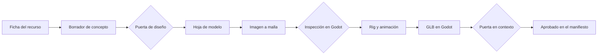

# Fase 0 — Investigación técnica, arquitectura y pipeline

> Documento de decisión. El detalle está en los informes de `Investigacion/` y en los datos de `Datos/`. Nada de aquí se ejecuta hasta que Guillermo lo apruebe.

## 0. Qué se decide en esta puerta

| ID | Decisión propuesta | Evidencia | ¿Cambia el plan maestro? |
|---|---|---|---|
| D-001 | Renderizador **Mobile**. Mundo 3D a 1280×720 escalado e interfaz a resolución nativa. Meta: 30 fps estables en este portátil. Compatibility queda como perfil de respaldo y Forward+ como perfil opcional para equipos potentes. | Medición propia, §2.1 | Sí: el plan pedía Forward+ |
| D-002 | Sin iluminación global en tiempo real. Una luz direccional con sombra corta, ambiente y relleno. Lightmaps horneados solo en interiores y después de probar el horneado aquí. | Medición y documentación, §2.3 | Responde a «SDFGI vs lightmaps» |
| D-003 | Personajes principales en **3D chibi**. El gato va en sprites, salvo que la prueba encuentre una vía de rig viable para cuadrúpedos. | Informe 02 verificado, §3 | No |
| D-004 | Pipeline: concepto barato → hoja de modelo → imagen a malla con Tripo H3.1 → inspección en Godot → rig → GLB. | Informes 02 y 03, §3 | Lo concreta |
| D-005 | Prueba de pipeline con **tope de 60 créditos** antes de la Fase 1. | §3.4 | La añade |
| D-006 | Presupuesto de los 1000 créditos por partidas, con reglas de gasto. | §4 | La añade |
| D-007 | Arquitectura con nodos, señales y `Resource`, sin ECS. Git LFS y CI con GitHub Actions. | §5 | Responde a «ECS vs OOP» |
| D-008 | Proceso de estudio: tres aprobaciones por recurso, manifiesto y límite de reintentos. | Informe 07, §6 | Lo concreta |
| D-009 | El pilar «mundo vivo» reserva contratos de interacción, tiempo, persistencia, audio y paleta desde ya. | Informe 10 verificado, §7 | Lo añade |
| D-010 | Del trabajo anterior se conservan la historia, los datos y la lógica de misión. La presentación visual se rehace. | Informe 08, §8 | No |

## 1. Punto de partida

- **Equipo:** Intel i5-7200U (2 núcleos), 7,9 GB de RAM e Intel HD Graphics 620. No hay GPU dedicada.
- **Motor:** Godot 4.7.2-stable. Arranca aquí con Forward+ (Vulkan 1.3 y D3D12), Mobile y Compatibility. Compatibility no usa el OpenGL de Intel: cae a ANGLE (OpenGL ES 3.0 sobre Direct3D 11).
- **Higgsfield:** plan Plus con 1006,25 créditos; 1000 son de suscripción y se acreditaron el 2026-11-12. Ofrece imagen, video, audio, sprites animados y 3D: imagen a malla, retopología, retexturizado y rig.
- **Meta visual:** el tablero de [[Analisis del tablero]]. Según el informe [[04_caso_after_the_wind]], ese juego se hizo en Godot con Tripo, Blender y Cascadeur, en unas seis semanas y con mucha dirección humana. Estos datos vienen de publicaciones que la verificación no pudo abrir: sirven de orientación, no de presupuesto.

## 2. Motor y renderizado

### 2.1 Medición en tu equipo

Fotogramas por segundo: media y, entre paréntesis, el 1 % más lento. Son 29 corridas de 10 a 12 s con `pruebas/bench_render/`.

| Renderizador | Base 720p | Hierba 720p | Sprites 720p | Base 1080p | Hierba 1080p |
|---|---|---|---|---|---|
| Mobile (Vulkan) | 90 (72) | 43 (36) | 75 (57) | 57 (33) | 32 (28) |
| Mobile (D3D12) | 114 (51) | 43 (36) | 98 (61) | sin medir | 31 (29) |
| Compatibility (ANGLE) | 73 (49) | 42 (28) | 41 (24) | 71 (46) | 32 (29) |
| Forward+ (Vulkan) | 68 (55) | 35 (30) | 58 (33) | 39 (32)* | 23 (19)* |
| Forward+ con SDFGI, SSAO y glow | 20 (9) | — | — | 13 (7)* | — |

\* Medido en ventana a 1920×1066.

- **Base:** 150 mallas con sombreado toon, unos 93 000 triángulos, 300 llamadas de dibujo y una luz con sombra.
- **Hierba:** la base más 40 000 briznas con viento (573 000 triángulos).
- **Sprites:** la base más 200 `Sprite3D` que proyectan sombra (700 llamadas de dibujo).

Lo que dicen los números:

1. **SDFGI no es viable aquí:** 20 fps con caídas a 9.
2. **Mobile es el más rápido a 720p y el más estable.** Con 700 llamadas de dibujo mantiene de 75 a 98 fps; Compatibility baja a 41.
3. **A 1080p con hierba densa todos rondan los 30 fps.** El límite es el relleno de píxeles. Por eso el 3D va a 720p y la interfaz a resolución nativa.
4. **Compatibility rinde parecido en escenas simples** y usa menos memoria de video (de 15 a 26 MiB frente a 82 a 145).

Límites de la medición: las escenas son sintéticas, no el juego. La corrida de Forward+ con D3D12 dio una cifra anómala (367 fps) y se descartó. El primer arranque de Forward+ tardó más de 90 s.

### 2.2 Qué ofrece cada renderizador

Datos de la documentación de Godot 4.7, verificados de forma independiente.

| Función | Forward+ | Mobile | Compatibility |
|---|---|---|---|
| SDFGI, VoxelGI, niebla volumétrica, FSR | Sí | No | No |
| Mostrar lightmaps horneados | Sí | Sí | Sí |
| Desenfoque de profundidad (tilt-shift) | Sí | Sí | No |
| Decals y proyectores de luz | Sí | Sí | No |
| FXAA y SMAA | Sí | Sí | No |
| Estelas de partículas | Sí | Sí | No |
| SSAO | Sí | No | Sí, simplificado |
| Glow, niebla de altura y MSAA 3D | Sí | Sí | Sí |
| Búfer de color | — | 10 bits con debanding | 8 bits |

Mobile conserva lo que el pilar «mundo vivo» necesita: desenfoque, decals, estelas y degradados de cielo sin bandas. Pierde el SSAO, que se sustituye por oclusión pintada en las texturas.

### 2.3 Iluminación global: SDFGI frente a lightmaps

- **SDFGI queda descartado** por la medición y porque solo existe en Forward+.
- **Los lightmaps horneados son viables en principio.** El horneado necesita una GPU con `RenderingDevice`, y la HD 620 la tiene. Falta medir cuánto tarda y cuánta memoria usa: se prueba con un interior pequeño en la prueba de pipeline.
- **Durante la iteración no hay GI.** Luz direccional, ambiente, un relleno y oclusión pintada. Los objetos móviles reciben luz indirecta por sondas si se hornea.

### 2.4 Sombras 3D sobre sprites 2D

- `Sprite3D` proyecta sombra con recorte alfa (`alpha_cut` en `discard`). El sombreado (`shaded`) viene apagado por defecto.
- Con billboard, la sombra gira con la cámara y con varias cámaras el resultado no está definido. Solución: un plano fijo «solo sombra» orientado a la luz, o una sombra de contacto redonda.
- Medido: 200 sprites con sombra a 75 fps en Mobile a 720p.

### 2.5 Sombreado estilizado

- `StandardMaterial3D` con difuso toon y rim en personajes. Shader propio solo donde haga falta.
- Contorno por casco invertido solo en personajes y objetos interactivos. El contorno por posproceso necesita un búfer que solo tiene Forward+.
- Textura pintada en el albedo, rugosidad constante y pocos materiales.
- Hierba en `MultiMesh` por parcelas, con viento en el shader.

### 2.6 Presupuesto inicial de rendimiento

Se calibra en la escena de la prueba de pipeline.

| Recurso | Triángulos | Textura | Materiales |
|---|---|---|---|
| Protagonista | 4000 a 6000 | 1024² | 1 o 2 |
| Gato | 2000 a 3000 | 512² | 1 |
| NPC cercano | 1500 a 3500 | 512² | 1 o 2 |
| Prop singular | 500 a 2000 | 512² | 1 |
| Escena visible | hasta 100 000 | atlas compartidos | hasta 300 llamadas de dibujo |

Hierba: hasta 20 000 briznas visibles, la mitad de lo que dio 43 fps.

### 2.7 Cámaras de partida

Son hipótesis para la prueba de pipeline. La decisión final es de la Fase 1.

- **Exploración:** perspectiva con campo de visión de 30° e inclinación de 55° hacia abajo, comparada con una cámara ortogonal en el mismo encuadre.
- **Hub lateral:** ortogonal, con pocas capas de profundidad y fondo ilustrado.
- **Desenfoque tilt-shift:** existe en Mobile. Su costo en este equipo está sin medir.

## 3. Pipeline de arte con IA

### 3.1 Flujo



En cada rombo decide Guillermo. La puerta en contexto se juzga con la cámara real y con los fps medidos.

### 3.2 Modelo por tarea

Costos medidos con `generate cost`.

| Tarea | Modelo | Créditos |
|---|---|---|
| Borrador de estilo o de concepto | `gpt_image_2_6`, calidad low, 1k | 0,25 |
| Final de concepto, textura o icono | `gpt_image_2_6`, calidad high, 1k / 2k | 1,5 / 2,75 |
| Maestro de personaje con referencias | `nano_banana_pro`, 2k | 2 |
| Vista adicional de un personaje | `3d_jutsu_angles`, 1k | 1,25 |
| Imagen a malla | `tripo_h3_1_image_to_3d` | 9 |
| Retopología / retexturizado | `meshy_v5_remesh` / `meshy_v5_retexture` | 6 / 9,5 |
| Animación de sprite | `autosprite`, turbo / pro | 2 / 3 |
| Música de 2 minutos | `sonilo_music` | 7,5 |
| Efecto de 3 segundos | `mirelo_text_to_audio` | 0,75 |

### 3.3 Riesgos comprobados

1. **Meshy se retira.** El proveedor retiró `lowpoly` el 30-10-2026 y retira Meshy 7 para geometría el 31-12-2026. La producción no se apoya en `meshy_v7_image_to_3d`.
2. **Mixamo solo acepta FBX, OBJ o ZIP.** Si Tripo entrega GLB hace falta convertirlo. Opciones: Blender por script (hay que instalarlo) o el rig de Higgsfield, `3d_rigging`, cuyo costo no se puede cotizar.
3. **El gato no tiene rig automático** dentro de Higgsfield. Plan seguro: sprites con `autosprite`.
4. **Cuatro modelos no se pueden cotizar:** `image_to_3d`, `multi_image_to_3d`, `3d_rigging` y `sam_3_3d`. Solo se prueban una vez y con permiso.
5. **Blender pide 4 núcleos** y este equipo tiene 2. Serviría por script, sin garantía de fluidez.
6. **La música generada tiene licencias por proveedor** que no están verificadas para publicar a través de Higgsfield.
7. **El rig es la mayor incógnita de costo.** Ocho personajes con rig por la única vía cotizada (Meshy 7) costarían de 352 a 380 créditos. La vía barata es Tripo a 9 créditos más un rig gratuito o sin cotizar: la prueba de pipeline existe para validarla.
8. **Los créditos del plan no se acumulan.** Según el apartado 9.4 de los términos de Higgsfield, los créditos de suscripción caducan al cierre de cada periodo de facturación. Los comprados aparte duran 90 días (apartado 9.6).

### 3.4 Prueba de pipeline

Usa un estudiante y un gato de prueba, no los diseños finales. Se detiene en el primer paso que falle.

| Paso | Qué se hace | Créditos |
|---|---|---|
| 1 | Referencias de prueba: 4 borradores, 2 finales y 2 vistas en pose A | 7 |
| 2 | Malla del protagonista con Tripo H3.1 (9). Malla del gato (9) solo si hay una vía de rig para cuadrúpedos. | 18 |
| 3 | Rig del protagonista: Mixamo (0 créditos) o una ejecución de `3d_rigging` | sin cotizar |
| 4 | Sprites del gato: caminar en 5 direcciones, reposo y una comparación en pro | 15 |
| 5 | Un sprite de control del protagonista y una textura de suelo | 3,5 |
| 6 | Escena en Godot con cámara 3/4 y cámara lateral, y horneado de un lightmap | 0 |
| | **Total cotizado / tope** | **43,5 / 60** |

Puerta de aceptación:

- Percentil 95 del tiempo de cuadro de 33 ms o menos, en un recorrido de 60 s a 720p.
- Ningún cambio de ropa, proporción o marcas entre direcciones.
- Lectura correcta en la cámara alta y en la lateral.
- Minutos de reparación manual anotados.
- Veredicto de Guillermo sobre una lámina comparativa y un video corto.

## 4. Presupuesto de créditos

| Partida | Créditos |
|---|---|
| Prueba de pipeline | 60 |
| Exploración y biblia visual | 20 |
| 8 personajes: maestros, vistas, expresiones y retratos | 110 |
| Hub, zona de exploración, materiales, cielos y capas | 70 |
| 40 props (diseño 2D) | 85 |
| Interfaz, iconos, logotipo, mapa y viñetas de carga | 87 |
| Utilidades: alfa, ediciones y ampliación | 25 |
| 5 pistas de música y 30 efectos | 115 |
| Voz y video, opcionales | 25 |
| Mallas 3D, retopología y rig | 160 |
| **Subtotal** | **757** |
| **Contingencia** | **243** |

Los 160 créditos de 3D alcanzan para unas 17 mallas de Tripo H3.1 sin rig de pago. No alcanzan para 40 props en malla: los props simples se construyen con geometría sencilla y textura pintada.

**Caducidad.** Los 1000 créditos se acreditaron el 2026-11-12 y caducan al cierre del periodo de facturación. Si el plan es mensual, eso ocurre hacia el 2026-12-12; la fecha exacta está por confirmar. Consecuencias:

- Las fases que generan arte (1, 3 y 5) tendrían que pasar sus puertas dentro de ese periodo, o se pierde el saldo sin usar.
- La contingencia que siga libre una semana antes del cierre se convierte en recursos ya aprobados: versiones finales, música y props.
- Si mantienes el plan, cada periodo trae otros 1000 créditos y el presupuesto se reparte por meses.

Reglas de gasto:

1. No se genera nada fuera de una partida aprobada.
2. Primero el borrador de 0,25 créditos; el final solo sobre un borrador aprobado.
3. Máximo 3 intentos por recurso y etapa. El cuarto exige cambiar de enfoque.
4. Lotes de 25 créditos como máximo, con revisión entre lotes.
5. Se vuelve a cotizar antes de cada lote y cada generación queda en el registro de [[trabajos]].

## 5. Arquitectura y estructura de datos

Detalle en [[06_arquitectura_godot]].

**ECS frente a nodos.** Se propone composición con nodos, datos en `Resource` y lógica en GDScript tipado, sin ECS. Con unos cientos de entidades no hay un cuello de botella que lo justifique. Cuatro informes llegaron por separado a la misma conclusión, y el trabajo anterior ya funcionaba así.

| Tema | Decisión |
|---|---|
| Entidades | Escenas compuestas por nodos. Las definiciones van en `Resource` y el estado de cada partida va aparte, para que dos instancias no compartan vida ni inventario. |
| Dependencias | Un `Main` persistente conecta los servicios y cambia las escenas del mundo. Pocos autoloads. |
| Comunicación | Señales locales y un bus pequeño de eventos de dominio. |
| Estados | Máquinas de estado propias y pequeñas. Godot State Charts 0.22.5 queda de reserva. |
| Lenguaje | GDScript tipado, con `gdlint` y `gdformat`. C# exige otra edición de Godot y otra cadena de exportación. |
| Guardado | JSON validado, con versión y migraciones, y dos generaciones de respaldo. Cargar un `Resource` de una partida puede ejecutar código. |
| Diálogos | Dialogue Manager 4.2.0 detrás de un adaptador propio. Dialogic 2 sigue en alfa. |
| Idiomas | gettext (`.po`), con español e inglés desde el inicio. |
| Cámara | `Camera3D` con un director propio. Phantom Camera 0.11.0.4 queda como opción: su autor avisa de errores pendientes del lado de Godot. |
| Gato | `NavigationAgent3D`, igual en la vista alta y en la lateral. |
| Audio | Nativo: buses, zonas y `AudioStreamInteractive`. |
| Pruebas | GUT 9.7.1 y ejecución sin ventana. |
| Tipografía | DotGothic16 tiene licencia SIL OFL 1.1 y declara el repertorio «GF Latin Core», que incluye tildes, ñ, ü, ¿ y ¡. Falta probar el archivo en Godot a tamaño de juego. |

Ningún complemento se ha ejecutado todavía en Godot 4.7.2. Cada uno pasa una prueba de aceptación antes de entrar.

**Repositorio propuesto**

```text
Juego 2d-hd/
├── juego/              proyecto de Godot: app, core, features, world, presentation, ui, content, assets, shaders y tests
├── arte_fuente/        originales generados y manifiestos
├── herramientas/       scripts de Higgsfield, Codex, validación y CI
├── Nasa_Game/          bóveda de Obsidian
├── pruebas/            pruebas técnicas, como bench_render
└── .github/workflows/  integración continua
```

- **Git LFS** para los binarios: imágenes, audio, modelos y fuentes. GitHub Free incluye 10 GiB de almacenamiento y 10 GiB de descarga por ciclo, con 2 GB por archivo. Cada versión de un binario ocupa su tamaño completo.
- **CI con GitHub Actions:** importación sin ventana, pruebas con GUT y exportación para Windows.
- **Accesibilidad desde la arquitectura:** remapeo de controles, escala de texto, paleta por datos para los modos de daltonismo y opción de reducir el movimiento.

## 6. Proceso de estudio

Detalle y plantillas en [[07_proceso_estudio]].

- **Tres aprobaciones por recurso:** de diseño (la hoja), técnica (triángulos, textura, rig) y en contexto (en el motor, con la cámara real).
- **Entregables de la Fase 1:** biblia de arte breve, hoja de modelo, hoja de expresiones, lineup de escala, color script y marcos de estilo de interfaz.
- **Comprobaciones objetivas por puerta:** silueta, lectura en grises, paleta, proporción en cabezas, legibilidad a la distancia de cámara y presupuesto técnico.
- **Manifiesto de recursos:** ID, estado, modelo, prompt, referencias, costo, archivo fuente, archivo en el motor y veredicto con fecha.
- **Consistencia con IA:** bloques de prompt fijos y versionados, imágenes ancla propias y un solo cambio por intento.

## 7. Pilar «mundo vivo»

Detalle en [[10_mundo_vivo]].

| Qué da vida | Cómo se resuelve | Costo en este equipo |
|---|---|---|
| Vegetación, telas y cables en movimiento | Viento por shader con parámetros globales | Bajo |
| Hierba que se dobla al pasar | Dos posiciones globales: protagonista y gato | Bajo |
| Polvo, hojas e insectos | Emisores de partículas pequeños y por proximidad | Bajo |
| Objetos que responden | Componente de interacción común, con aviso y resaltado | Bajo |
| El mundo recuerda | Identificadores estables y estados guardados | Nulo |
| NPC con rutinas | Horarios escritos, sin simular a toda la población | Bajo |
| Sonido coherente | Buses, capas de ambiente por zona, pasos por superficie y música adaptativa nativa | Bajo |
| Paleta consistente | Paleta maestra como dato, rampas compartidas y comprobación automática por recurso | Nulo |

Desde ya se reservan: señales globales, capas de colisión, grupos, parámetros globales de shader, buses de audio y el formato de datos de zona. El audio usa el sistema nativo de Godot, sin FMOD ni Wwise.

## 8. Trabajo anterior

Detalle en [[08_antecedentes_boveda_anterior]].

- **Se conserva:** la historia (Guayaquil, formación, misión y transmisión del conocimiento), las clases de datos, el catálogo de misiones, la mecánica orbital con sus pruebas y el esquema de personalización y guardado.
- **Se rehace:** avatar, gato, muebles, cámara, escala e interfaz.
- **Se descarta:** el píxel-art y la resolución de 384×216.
- **Aviso:** en esa carpeta hay trabajo sin confirmar en Git (prólogo, creador de avatar y guardado). Conviene confirmarlo antes de tocar nada.

## 9. Preguntas para Guillermo

1. ¿Aceptas Mobile como renderizador base en lugar de Forward+?
2. ¿Autorizas la prueba de pipeline con tope de 60 créditos y personajes de prueba?
3. ¿Cuándo se renueva tu plan de Higgsfield y piensas mantenerlo?
4. ¿Instalas Blender 4.5 LTS y tienes cuenta de Adobe para Mixamo, o prefieres pagar el rig con créditos?
5. ¿Hay fecha límite y cuál es la plataforma objetivo?
6. ¿Inicializo Git y Git LFS aquí, y en qué repositorio remoto?

## 10. Evidencia

| Fuente | Qué aporta | Estado |
|---|---|---|
| `pruebas/bench_render/` | 29 corridas en este equipo | Medido |
| `Datos/hf_costos_matriz.md` | 169 cotizaciones de Higgsfield | Medido, sin gastar créditos |
| Informes 01 a 10 de Codex | Investigación con fuentes | Revisados |
| Verificación independiente | Contraste de las afirmaciones clave con fuentes primarias | Ver tabla |

| Informe | Confirmadas | Imprecisas | Sin poder verificar | Refutadas |
|---|---|---|---|---|
| 01 Motor y render | 13 | 2 | 1 | 0 |
| 02 Pipeline de personajes | 13 | 3 | 0 | 0 |
| 03 Arte 2D y presupuesto | 12 | 3 | 0 | 0 |
| 04 y 07 (muestreo) | 7 | 3 | 2 | 0 |
| 05 Referentes (muestreo) | 9 | 1 | 0 | 0 |
| 06 Arquitectura | 12 | 2 | 0 | 0 |
| 10 Mundo vivo | 10 | 2 | 1 | 0 |

En total: 76 afirmaciones confirmadas, 16 imprecisas, 4 sin poder verificar y ninguna refutada.

La corrección más importante de la verificación: los informes de Codex recomendaban Compatibility sin medirlo. La medición favorece a Mobile, y eso es lo que propone este documento.

Sin verificar todavía: el horneado de lightmaps en este equipo, la ejecución de los complementos en Godot 4.7.2, DotGothic16 dentro de Godot, el costo de `3d_rigging` y los datos de cómo se hizo el juego del tablero.
