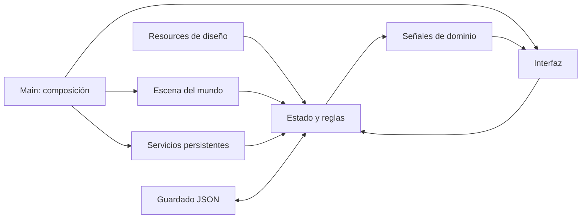

# Fase 0 — Arquitectura, repositorio y herramientas para Godot 4.7.2

## Resumen ejecutivo

Recomiendo **composición con nodos, datos de diseño en Resources y lógica en GDScript tipado**, sin ECS como dependencia inicial. Un `Main` persistente conectará los servicios y sustituirá las escenas del mundo; las entidades recibirán sus dependencias explícitamente.

La base propuesta utiliza FSM/HSM pequeñas, guardado JSON con migraciones, Dialogue Manager 4.2.0, audio nativo y GUT 9.7.1. Phantom Camera 0.11.0.4 queda como incorporación opcional. Hay evidencia documental para Godot 4.7; **ningún complemento se ha ejecutado aquí en 4.7.2**.

El repositorio separará el proyecto Godot, la bóveda `Nasa_Game/`, las herramientas y los originales artísticos. Git conservará código y metadatos; Git LFS gestionará los binarios seleccionados.

La arquitectura permitirá un perfil gráfico económico sin alterar las reglas del juego. El rendimiento real en la HD 620 queda **sin verificar** y exige una prueba local.

Este informe es una propuesta: no se instalaron herramientas, no se modificaron archivos y no se ejecutaron operaciones de Higgsfield.

## Decisiones recomendadas

Las recomendaciones de esta tabla son **[inf]**; su fundamento documental aparece en las secciones siguientes.

| Decisión | Recomendación | Alternativa descartada y por qué | Confianza alta/media/baja |
|---|---|---|---|
| Arquitectura de entidades | Escenas compuestas por nodos; cálculos y registros simples fuera del árbol | ECS general desde el inicio: añade integración sin un cuello de botella medido | Alta |
| Datos | Resources personalizados para definiciones; estado mutable independiente por partida | Modificar las definiciones compartidas para representar cada instancia: facilita contaminación entre entidades | Alta |
| Dependencias | `Main` persistente, referencias tipadas y `setup(context)` | Autoload para cada sistema: oculta dependencias y dificulta pruebas | Alta |
| Comunicación | Señales locales y un bus pequeño de acontecimientos de dominio | Bus universal de órdenes y mensajes de texto: vuelve implícito el flujo | Alta |
| Estados | FSM propias pequeñas; HSM cuando exista jerarquía real | LimboAI como requisito inicial: capacidad adicional que todavía no se necesita | Alta |
| Lenguaje | GDScript tipado | C# o C++ por anticipación: aumentan la cadena de compilación y distribución | Alta |
| Guardado | JSON validado, identificadores estables y migraciones explícitas | Cargar Resources de partidas externas: pueden incorporar scripts | Alta |
| Diálogos | Dialogue Manager 4.2.0, detrás de un adaptador propio | Dialogic 2 como base: continúa en alfa y su última versión cambia la compatibilidad de partidas | Alta |
| Localización | gettext `.po`, español e inglés; identificadores estables | CSV como formato principal del RPG: menos cómodo para contexto, revisiones y texto extenso | Alta |
| Cámara y gato | `Camera3D` mediante un director; `NavigationAgent3D` para el gato | Dos sistemas de navegación por cambiar el ángulo de cámara: duplicaría lógica | Alta |
| Audio | Audio nativo, buses y zonas | FMOD/Wwise inicialmente: añaden herramientas, bibliotecas y licencias de middleware | Alta |
| Pruebas y entrega | GUT 9.7.1, importación headless y exportación Windows en Actions | Dos frameworks de pruebas o compilación del motor: mantenimiento innecesario | Alta |
| Perfil de desarrollo | Mantener la lógica independiente del renderizador; proponer Compatibility como base económica | Dar Forward+ por validado únicamente porque el motor arranca | Media |

## Afirmaciones que sostienen las decisiones

1. **[doc] Godot recomienda escenas con pocas dependencias externas e inyección de dependencias desde sus propietarios.** Los Resources sirven como contenedores de datos y pueden compartirse entre instancias. Fuentes: [organización de escenas](https://docs.godotengine.org/en/4.7/tutorials/best_practices/scene_organization.html), [Resources](https://docs.godotengine.org/en/4.7/tutorials/scripting/resources.html).

2. **[doc] GECS mantiene una implementación ECS integrada con Godot.** La versión consultada, 9.3.4, declara Godot 4.6 o posterior. Eso acredita un requisito declarado, no una prueba específica en este equipo ni en 4.7.2. Fuente: [README de GECS 9.3.4](https://github.com/csprance/gecs/blob/v9.3.4/README.md).

3. **[doc] State Charts 0.22.5 contiene una corrección explícita para Godot 4.7. LimboAI 1.8.1 publica compilaciones del motor actualizadas a 4.7.2.** Fuentes: [cambios de State Charts](https://github.com/derkork/godot-statecharts/blob/v0.22.5/CHANGES.md), [LimboAI 1.8.1](https://github.com/limbonaut/limboai/releases/tag/v1.8.1).

4. **[doc] Tener .NET instalado no basta para programar Godot en C#: se necesitan el SDK y la edición de Godot con soporte .NET.** Las GDExtension requieren bibliotecas compatibles con la plataforma y el motor. Fuentes: [C#](https://docs.godotengine.org/en/4.7/tutorials/scripting/c_sharp/c_sharp_basics.html), [compatibilidad de GDExtension](https://docs.godotengine.org/en/4.7/tutorials/scripting/cpp/about_godot_cpp.html#version-compatibility).

5. **[doc] Deserializar objetos puede ejecutar código.** Godot advierte expresamente sobre `FileAccess.get_var(true)`; el repositorio del motor también documenta el problema de cargar Resources que incorporan scripts. Fuentes: [FileAccess](https://docs.godotengine.org/en/4.7/classes/class_fileaccess.html), [propuesta upstream sobre carga segura](https://github.com/godotengine/godot-proposals/issues/4925).

6. **[doc] Dialogue Manager 4.2.0 se publica para Godot 4.7. Dialogic 2.0 alpha 20 corrige problemas con 4.7, pero introduce cambios que rompen partidas anteriores.** Fuentes: [Dialogue Manager 4.2.0](https://github.com/nathanhoad/godot_dialogue_manager/releases/tag/v4.2.0), [Dialogic alpha 20](https://github.com/dialogic-godot/dialogic/releases/tag/2.0-alpha-20).

7. **[doc] DotGothic16 utiliza SIL OFL 1.1 y declara GF Latin Core.** Ese repertorio incluye los caracteres españoles solicitados. La comprobación del archivo concreto dentro de Godot queda **sin verificar**. Fuentes: [repertorio declarado](https://github.com/fontworks-fonts/DotGothic16), [licencia](https://github.com/fontworks-fonts/DotGothic16/blob/master/OFL.txt), [GF Latin Core](https://github.com/googlefonts/glyphsets/blob/main/data/results/txt/nice-names/GF_Latin_Core.txt).

8. **[doc] Phantom Camera 0.11.0.4 es una versión publicada; la 0.11.0.3 corrigió un problema introducido en Godot 4.7.1.** Su funcionamiento completo en 4.7.2 queda **sin verificar mediante ejecución**. Fuente: [publicaciones de Phantom Camera](https://github.com/ramokz/phantom-camera/releases).

9. **[doc] `NavigationAgent3D` proporciona seguimiento de rutas y evitación, pero necesita datos de navegación y actualización durante la física.** El movimiento del cuerpo sigue siendo responsabilidad del juego. Fuente: [NavigationAgent3D](https://docs.godotengine.org/en/4.7/classes/class_navigationagent3d.html).

10. **[doc] Godot ofrece música interactiva y pistas sincronizadas de forma nativa. En 4.7, `AudioStreamPlayer3D.area_mask` vale 0 por defecto**, por lo que las zonas de audio requieren configurarlo explícitamente. Fuentes: [AudioStreamInteractive](https://docs.godotengine.org/en/4.7/classes/class_audiostreaminteractive.html), [AudioStreamSynchronized](https://github.com/godotengine/godot-docs/blob/4.7/classes/class_audiostreamsynchronized.rst), [AudioStreamPlayer3D](https://docs.godotengine.org/en/4.7/classes/class_audiostreamplayer3d.html).

11. **[doc] GitHub Free y Pro incluyen actualmente 10 GiB de almacenamiento LFS y 10 GiB de descarga por ciclo; su límite por archivo LFS es 2 GB.** Cada versión modificada de un binario vuelve a ocupar su tamaño completo. Fuentes: [facturación LFS](https://docs.github.com/en/billing/concepts/product-billing/git-lfs), [límites por archivo](https://docs.github.com/en/repositories/working-with-files/managing-large-files/about-git-large-file-storage).

12. **[doc] GUT 9.7.1 declara compatibilidad con Godot 4.7.x.** Godot permite importar y exportar desde consola; exportar requiere el editor y las plantillas correspondientes. Fuentes: [matriz de GUT](https://github.com/bitwes/Gut), [consola de Godot](https://docs.godotengine.org/en/4.7/tutorials/editor/command_line_tutorial.html).

## Riesgos y cómo mitigarlos

Las medidas siguientes son **[inf]**, propuestas para este proyecto.

| Riesgo | Mitigación |
|---|---|
| Confundir compatibilidad documental con funcionamiento probado | Registrar por separado versión, requisito declarado, prueba en 4.7.2 y prueba en la HD 620 |
| Agotar RAM al mantener todas las entidades activas | Conservar registros del mundo y activar escenas por zona; reducir decisiones periódicas y agentes lejanos |
| Compartir accidentalmente salud, inventario o apariencia mutable | Mantener las definiciones como datos de solo lectura por convención y crear estado por instancia |
| Perder una partida durante una escritura | Alternar dos generaciones válidas, escribir primero un temporal y conservar la anterior hasta validar la nueva |
| Atar las partidas a un complemento | Guardar progreso narrativo y misiones en el dominio propio; utilizar adaptadores |
| Consumir disco y cuota LFS con variantes de IA | Versionar recursos aprobados; conservar cachés y descartes fuera del historial principal |
| Que `gdtoolkit` no reconozca alguna sintaxis de 4.7 | Probar el corpus del proyecto antes de fijarlo como puerta obligatoria; el parser del motor sigue siendo la autoridad |
| Que el gato se atasque o provoque recálculos continuos | Umbrales de distancia, actualización escalonada del objetivo y recuperación controlada |
| Que un filtro de color reduzca legibilidad | Diseñar señales por forma y texto; validar paletas alternativas antes de añadir posprocesado |
| Que el informe se interprete como rendimiento garantizado | Tratar todos los presupuestos como objetivos pendientes de medición |

Existe además una **discrepancia de licencia en GECS**: el `LICENSE` de 9.3.4 contiene CC0-1.0, mientras su README menciona MIT. No lo incorporaría sin aclarar esa discrepancia. **[doc]** [LICENSE](https://github.com/csprance/gecs/blob/v9.3.4/LICENSE), [README](https://github.com/csprance/gecs/blob/v9.3.4/README.md).

## Preguntas que debe decidir el usuario

1. ¿Se acepta **Compatibility como perfil inicial de desarrollo**, manteniendo Forward+ como perfil sujeto a la prueba de renderizado?
2. ¿El personaje tendrá salto y plataformas, o movimiento terrestre con interacción? Esto determina si hace falta coyote time.
3. ¿El primer prototipo tendrá un espacio de partida con autoguardado o varios espacios seleccionables?
4. ¿Español e inglés deben estar completos desde el primer prototipo o se permite inglés parcial durante producción?
5. ¿Se prefiere cámara propia al principio o incorporar Phantom Camera desde la primera escena?
6. ¿La primera entrega será un artefacto privado de GitHub o una publicación de prueba en itch.io?

Estas decisiones pertenecen a la puerta de validación; no impiden completar el diseño técnico de este informe.

## Desarrollo

### 1. Alcance y nivel de verificación

Se revisaron la estructura local, el plan maestro y fuentes primarias de Godot y de los complementos. La publicación oficial de **Godot 4.7.2-stable** también está verificada documentalmente. **[doc]** [Publicación del motor](https://github.com/godotengine/godot/releases/tag/4.7.2-stable).

Conviene distinguir:

| Estado | Significado en este informe |
|---|---|
| Documentado | La documentación o publicación upstream respalda la afirmación |
| Declarado | El mantenedor anuncia un intervalo compatible, sin acreditar todas sus combinaciones |
| Probado localmente | Requiere ejecución en el equipo del usuario; no se realizó |
| Sin verificar | La evidencia consultada no permite afirmarlo |

**[inf]** La arquitectura propuesta no depende de SDFGI, de un middleware propietario ni de compilar Godot. El cambio de renderizador deberá afectar a presentación, iluminación y materiales; las reglas, partidas, diálogos y controles conservarán sus contratos.

### 2. Arquitectura: composición y separación del estado

Godot favorece escenas reutilizables y relaciones mediadas por sus propietarios. Recomienda inyección cuando una escena necesita colaboradores externos. **[doc]** [Organización de escenas](https://docs.godotengine.org/en/4.7/tutorials/best_practices/scene_organization.html).

**[inf] Propuesta:**



La estructura persistente sería:

```text
Main
├── Services
│   ├── SaveService
│   ├── SettingsService
│   ├── AudioDirector
│   └── SceneFlow
├── Session
│   ├── WorldState
│   ├── QuestService
│   └── DomainEvents
├── WorldSlot
│   └── ZonaActual
└── UILayer
    ├── HUD
    ├── DialogueView
    └── MenuStack
```

**[inf]** `Main` permanece durante la sesión. `SceneFlow` cambia el contenido de `WorldSlot`, en lugar de destruir la raíz de la aplicación en cada transición. Una partida nueva reemplaza `Session`; salir al título libera el mundo y su estado.

Una entidad reutilizable podría organizarse así:

```text
Player — CharacterBody3D
├── CollisionShape3D
├── VisualRoot
│   └── Representación visual
├── MovementController
├── InteractionSensor — Area3D
├── ActionStateMachine
└── AudioEmitter
```

**[inf]** No convertiría cada atributo en un nodo: una resistencia, una cantidad de inventario o un valor eléctrico son datos. Los nodos se justifican cuando aportan integración con escena, física, señales, animación o presentación.

#### Definiciones frente a instancias

Godot puede reutilizar un mismo Resource cargado en varios lugares. Eso es útil para definiciones compartidas, pero exige cuidado al modificarlas. **[doc]** [Resources](https://docs.godotengine.org/en/4.7/tutorials/scripting/resources.html).

**[inf] Separación recomendada:**

| Tipo | Representación | Contenido |
|---|---|---|
| `ItemDefinition` | Resource `.tres` | ID, claves de traducción, icono, propiedades de diseño |
| `ItemStack` | Estado por instancia | ID de definición, cantidad, desgaste |
| `QuestDefinition` | Resource `.tres` | Objetivos, condiciones y recompensas |
| `QuestProgress` | Estado de partida | Etapa actual, contadores, acontecimientos completados |
| `CharacterDefinition` | Resource `.tres` | Valores iniciales y referencias aprobadas |
| `CharacterState` | Estado por instancia | Salud actual, posición, inventario y apariencia |
| `ExperimentDefinition` | Resource `.tres` | Parámetros, unidades y restricciones del dispositivo |
| `ExperimentState` | Estado de partida | Montaje y valores manipulados por el jugador |

**[inf]** Las definiciones serán de solo lectura **por convención del proyecto**. Para el estado mutable usaría clases pequeñas `RefCounted` o estructuras explícitas. No confiaría en duplicaciones indiscriminadas de Resources anidados para resolver la propiedad de los datos.

#### Autoloads, señales e inyección

**[inf]** La base necesita **cero autoloads propios** si `Main` permanece. Los autoloads exigidos por los complementos deben registrarse como dependencias adicionales.

La inyección será sencilla:

- Referencias exportadas para componentes que pertenecen a una escena.
- `setup(context)` para servicios proporcionados por quien instancia la escena.
- Dependencias obligatorias comprobadas al inicializar.
- Dobles de prueba para reloj, guardado y acontecimientos.
- Evitar búsquedas permanentes mediante rutas absolutas o un localizador global.

**[inf]** Las señales locales comunicarán componentes próximos. `DomainEvents` distribuirá acontecimientos entre sistemas, por ejemplo `item_acquired`, `quest_stage_changed` o `experiment_completed`.

El bus transportará identificadores y valores explícitos. Las órdenes —comprar, guardar, iniciar una interacción— irán al servicio responsable, que devolverá un resultado. Esto mantiene visible quién puede modificar el estado.

### 3. ECS: estado y condiciones para adoptarlo

GECS 9.3.4 declara Godot 4.6+, consultas por componentes e integración con escenas. Godex se presenta como módulo del motor; el repositorio consultado mostraba su último cambio principal en 2023 y no proporcionó una versión compatible con 4.7 verificada. **[doc]** [GECS](https://github.com/csprance/gecs/blob/v9.3.4/README.md), [Godex](https://github.com/GodotECS/godex).

**[inf]** Para este RPG, “pocos cientos de entidades” no justifica por sí solo un ECS. Importa qué hacen: cientos de registros de inventario o NPC descargados son distintos de cientos de cuerpos navegando y animándose simultáneamente.

Aplicaría primero:

1. Carga por zonas.
2. Separación entre registros y representaciones activas.
3. Decisiones de NPC escalonadas.
4. Reducción de búsquedas y asignaciones durante cada cuadro.
5. Perfilado de los sistemas costosos.

**[inf]** Un ECS merece una prueba cuando exista procesamiento repetitivo de grandes conjuntos homogéneos, combinaciones de componentes difíciles de mantener o un coste medido que la composición actual no resuelva. La comparación debe usar la misma carga y medir tiempo de CPU, memoria y complejidad de implementación.

No hay un umbral universal de entidades a partir del cual un complemento ECS sea más rápido; ese resultado queda **sin verificar** para este proyecto.

### 4. Máquinas de estado

State Charts 0.22.5 corrige compatibilidad con 4.7. LimboAI combina árboles de comportamiento y HSM; su versión 1.8.1 dispone de compilaciones del motor 4.7.2. **[doc]** [State Charts](https://github.com/derkork/godot-statecharts/blob/v0.22.5/CHANGES.md), [LimboAI](https://github.com/limbonaut/limboai/releases/tag/v1.8.1).

**[inf] Recomendación inicial:**

| Ámbito | Máquina propuesta |
|---|---|
| Flujo de juego | Exploración, diálogo, dispositivo, transición y pausa |
| Acción del personaje | Libre, interactuando, acción bloqueante y recuperación |
| Gato | Reposo, seguimiento, inspección, asistencia y recuperación |
| Dispositivo científico | Configuración, ejecución, resultado y reinicio |

**[inf]** Empezaría con FSM pequeñas. Añadiría jerarquía cuando varios estados compartan comportamiento de entrada, salida o interrupción; por ejemplo, un padre `Active` para los estados del gato que pueden interrumpirse por cambio de zona.

Reglas:

- Un único propietario autoriza cada transición.
- `enter`, `exit` y actualización tienen responsabilidades definidas.
- Las transiciones solicitadas durante una señal se encolan para evitar reentradas.
- La animación refleja el estado de juego.
- El guardado conserva estados persistentes del dominio, no referencias internas de la máquina.

**[inf]** State Charts sería la primera alternativa si la edición visual y los estados paralelos aportan valor. LimboAI se reservaría para comportamientos que se beneficien de árboles de comportamiento y su depurador. No mantendría dos frameworks de estados en paralelo.

### 5. Lenguaje, estilo y análisis estático

GDScript admite tipado estático. La guía oficial utiliza `snake_case` para archivos, funciones y variables, `PascalCase` para clases y nodos, y `CONSTANT_CASE` para constantes. **[doc]** [Tipado](https://docs.godotengine.org/en/4.7/tutorials/scripting/gdscript/static_typing.html), [estilo](https://docs.godotengine.org/en/4.7/tutorials/scripting/gdscript/gdscript_styleguide.html).

**[inf]** Recomiendo GDScript tipado para toda la primera implementación:

- Tipos explícitos en parámetros, retornos, propiedades públicas y señales.
- `Variant` limitado a fronteras como JSON o APIs dinámicas.
- Conversión del JSON a modelos validados antes de usarlo.
- Archivos pequeños por responsabilidad.
- Física en su actualización correspondiente; reglas científicas separadas de la presentación.
- Reloj y aleatoriedad inyectables cuando deban probarse.
- Unidades explícitas en los datos: segundos, metros, voltios y otras magnitudes.

**C#** sigue siendo una alternativa válida si aparece una biblioteca imprescindible o un trabajo de cálculo que lo justifique. No se verificaron la edición del Godot descargado ni la versión exacta del SDK .NET instalado. **[doc]** [Requisitos de C#](https://docs.godotengine.org/en/4.7/tutorials/scripting/c_sharp/c_sharp_basics.html).

**GDExtension** se reservará para integrar una biblioteca nativa o resolver un cuello de botella demostrado. Su compatibilidad depende también de plataforma y precisión de compilación. **[doc]** [Compatibilidad](https://docs.godotengine.org/en/4.7/tutorials/scripting/cpp/about_godot_cpp.html#version-compatibility).

#### gdtoolkit

La versión consultada de PyPI es **gdtoolkit 4.5.0**, licencia MIT, con requisito declarado Python ≥3.7. Proporciona `gdlint` y `gdformat`. La compatibilidad completa de su gramática con GDScript 4.7 y su ejecución con el Python 3.13 instalado quedan **sin verificar**. **[doc]** [PyPI](https://pypi.org/project/gdtoolkit/).

**[inf]** Tras validarlo, se fijará esa versión y su configuración. El análisis se aplicará a código propio, sin reformatear complementos externos.

Comandos propuestos, **no ejecutados**:

```text
gdformat --check juego/core juego/features juego/ui juego/tests
gdlint juego/core juego/features juego/ui juego/tests
```

El formateador verifica estilo; no sustituye la importación del motor ni las pruebas.

### 6. Guardado seguro, versionado y migraciones

| Formato | Ventaja | Limitación | Uso recomendado |
|---|---|---|---|
| Resources | Integración con Inspector y tipos propios | Pueden referenciar o incorporar scripts | Definiciones distribuidas con el juego |
| JSON | Inspeccionable y sencillo de migrar | Requiere esquema, validación y conversiones explícitas | Partidas y ajustes iniciales |
| Binario de valores | Puede reducir tamaño y trabajo de serialización | Menos fácil de inspeccionar; necesita contrato de versión | Solo después de medir necesidad |

JSON no representa directamente todos los tipos de Godot y sus números necesitan tratamiento explícito al reconstruir el modelo. **[doc]** [JSON](https://docs.godotengine.org/en/4.7/classes/class_json.html).

**[inf]** Cada partida tendrá una envoltura con:

- `schema_version`: versión de la estructura.
- `content_version`: revisión del contenido al que se refiere.
- `game_build`: identificación de compilación.
- `generation`: orden de escritura.
- `payload`: estado persistente.

**[inf]** Se guardarán identificadores estables, posiciones expresadas como números, cantidades y progreso. Se reconstruirán vectores y clases mediante código conocido. No se guardarán rutas arbitrarias, objetos del árbol, identificadores de instancia ni índices de enum cuyo significado pueda cambiar.

#### Riesgo de Resources

**No cargaría una partida mediante `ResourceLoader.load()`**, aunque su extensión sea `.tres` o `.res`. Cambiar a un Resource binario no elimina por sí mismo la posibilidad de referencias ejecutables. La propuesta upstream sobre carga segura documenta ese problema; no acredita una garantía general de carga segura en 4.7.2. **[doc]** [Propuesta de carga sin scripts](https://github.com/godotengine/godot-proposals/issues/4925).

La advertencia de `get_var(true)` es explícita. Si posteriormente se emplea serialización binaria de valores, se mantendrá desactivada la deserialización de objetos. **[doc]** [FileAccess](https://docs.godotengine.org/en/4.7/classes/class_fileaccess.html).

#### Escritura y recuperación

**[inf] Procedimiento recomendado:**

1. Capturar un estado coherente, sin modificarlo durante la serialización.
2. Validar campos, tamaños y valores permitidos.
3. Escribir un archivo temporal.
4. Cerrarlo, releerlo y comprobar que puede recuperarse.
5. Instalarlo como nueva generación en el espacio inactivo.
6. Conservar la generación anterior válida.

**[inf]** Al arrancar se elegirá la generación válida más reciente. Un fallo no debe destruir la única copia recuperable. La estrategia debe probarse con interrupciones y errores de disco; no se afirma aquí una garantía absoluta de atomicidad en Windows.

#### Migraciones

**[inf]** Cada cambio de esquema tendrá una función secuencial, como `migrate_v1_to_v2`, y una partida de prueba de la versión antigua.

La migración:

- Trabajará sobre una copia.
- Validará antes y después.
- Conservará el original hasta completar la operación.
- Rechazará versiones futuras desconocidas.
- Resolverá cambios de identificadores mediante tablas explícitas.

Los ajustes —idioma, controles y accesibilidad— se almacenarán separados de la partida para poder aplicarlos antes del menú inicial.

### 7. Diálogos, localización y tipografía

#### Dialogue Manager frente a Dialogic 2

Dialogue Manager se describe como un sistema de diálogo ramificado sin estado propio de juego. Su documentación permite traducciones CSV o gettext y claves estáticas por línea. **[doc]** [Proyecto](https://github.com/nathanhoad/godot_dialogue_manager), [traducciones de 4.2.0](https://github.com/nathanhoad/godot_dialogue_manager/blob/v4.2.0/docs/Translations.md).

**[inf]** Esa separación encaja con el RPG: el progreso de misiones, inventario y descubrimientos pertenece al dominio. Un `DialogueService` adaptará las consultas y operaciones permitidas.

No se expondrá todo el árbol a las expresiones del diálogo. El contexto proporcionará métodos concretos, por ejemplo consultar una misión o entregar una recompensa de forma controlada.

Dialogic 2 ofrece un flujo de edición más orientado a secuencias visuales y presentación narrativa. Sin embargo, alpha 20 sigue siendo una versión alfa y anuncia cambios incompatibles en subsistemas y partidas. **[doc]** [Publicación alpha 20](https://github.com/dialogic-godot/dialogic/releases/tag/2.0-alpha-20).

#### Español e inglés

Godot admite CSV y gettext. La documentación destaca la separación por idioma y comodidad de revisión de los archivos PO. **[doc]** [CSV](https://docs.godotengine.org/en/4.7/tutorials/i18n/localization_using_spreadsheets.html), [gettext](https://docs.godotengine.org/en/4.7/tutorials/i18n/localization_using_gettext.html).

**[inf] Recomendación:**

- Un `.pot` como plantilla y `.po` para `es` y `en`.
- Claves estables para interfaz, objetivos y diálogos.
- Contexto y notas para el traductor.
- Mensajes completos con parámetros; evitar concatenar fragmentos traducidos.
- Plurales mediante el sistema de localización.
- Comprobaciones de claves, parámetros y mensajes pendientes.
- Nombres y texto fuera de las imágenes del HUD.

CSV puede seguir utilizándose como intercambio editorial, pero no mantendría dos fuentes maestras de traducción.

#### DotGothic16

**La cobertura documental es favorable:** DotGothic16 declara GF Latin Core, que contiene `aacute`, `eacute`, `iacute`, `oacute`, `uacute`, `ntilde`, `udieresis`, `questiondown` y `exclamdown`, correspondientes a **á é í ó ú ñ ü ¿ ¡**. **[doc]** [Fuente](https://github.com/fontworks-fonts/DotGothic16), [repertorio](https://github.com/googlefonts/glyphsets/blob/main/data/results/txt/nice-names/GF_Latin_Core.txt).

Su licencia es **SIL OFL 1.1**. Se conservarán el aviso y la licencia al distribuirla. **[doc]** [OFL de DotGothic16](https://github.com/fontworks-fonts/DotGothic16/blob/master/OFL.txt).

**[inf]** Antes de aprobarla se comprobará el archivo realmente incorporado mediante `Font.has_char()` y una pantalla de muestra, sin sustituciones que oculten ausencias. Godot dispone de introspección de caracteres y fuentes de respaldo. **[doc]** [Font](https://docs.godotengine.org/en/4.7/classes/class_font.html).

Si falla la cobertura o la lectura a los tamaños necesarios, las alternativas candidatas son **Pixelify Sans** y **Silkscreen**, ambas catalogadas por Google Fonts con OFL y repertorios latino y latino extendido. La cobertura individual del archivo elegido y su lectura en Godot quedan **sin verificar**. **[doc]** [Pixelify Sans](https://github.com/google/fonts/blob/main/ofl/pixelifysans/METADATA.pb), [Silkscreen](https://github.com/google/fonts/blob/main/ofl/silkscreen/METADATA.pb).

### 8. Cámara, navegación, entrada y audio

#### Cámara

Phantom Camera trabaja sobre `Camera2D` y `Camera3D`; su historial incluye correcciones específicas de Godot 4.7.1 y de activación del complemento. **[doc]** [Proyecto](https://github.com/ramokz/phantom-camera), [publicaciones](https://github.com/ramokz/phantom-camera/releases).

**[inf]** Recomiendo un `CameraDirector` propio como interfaz estable, con perfiles de exploración, diorama, conversación e inspección. Puede controlar inicialmente `Camera3D` y delegar después en Phantom Camera.

El resto del juego pedirá un perfil o un objetivo; no manipulará directamente nodos del complemento. La reducción de movimiento se aplicará desde ese director.

**[inf]** Cambiar a una vista lateral no obliga a convertir el hub en un mundo físico 2D. Mantenerlo en 3D facilita reutilizar entidades, interacciones y navegación.

#### Navegación del gato

**[inf]** Para un mundo físico 3D:

- `CharacterBody3D` como cuerpo.
- `NavigationAgent3D` como ayudante de navegación.
- Regiones con navegación preparada por zona.
- Seguimiento sobre XZ cuando el movimiento sea terrestre.
- Objetivo situado a una distancia cómoda del jugador.
- Estados de inspección y asistencia que puedan suspender el seguimiento.

Los agentes requieren actualizar su ruta en física; modificar el objetivo provoca consultas de navegación. La evitación es un mecanismo distinto del desplazamiento y de las colisiones físicas. **[doc]** [Uso de agentes](https://docs.godotengine.org/en/4.7/tutorials/navigation/navigation_using_navigationagents.html).

**[inf]** Se limitarán los cambios de objetivo por tiempo y distancia; no se reasignará innecesariamente cada cuadro. La evitación se activará donde aporte valor y se evaluará primero de forma planar.

El controlador esperará a que el mapa esté sincronizado, comprobará destinos inalcanzables y tendrá recuperación tras un atasco persistente. Se probarán puertas, cambios de zona, escaleras y pérdida del objetivo.

`NavigationAgent2D` se reservará para escenas cuya simulación sea realmente 2D. El ángulo de cámara no determina el servidor de navegación.

#### Entrada

Godot permite representar acciones mediante `InputMap` y asignar varios eventos a una misma acción. **[doc]** [InputEvent](https://docs.godotengine.org/en/4.7/tutorials/inputs/inputevent.html).

**[inf]** Un `InputRouter` separará los contextos de juego, interfaz, diálogo y dispositivos. El movimiento no se ejecutará mientras un contexto modal tenga el control.

El buffer conservará acciones brevemente para consumirlas una sola vez cuando el estado lo permita. Su duración será un parámetro de ajuste; no existe aquí un valor validado.

**[inf]** El coyote time solo se implementará si existe salto o una mecánica equivalente de abandono de apoyo. Para caminar e interactuar no hace falta añadirlo.

En Godot 4.7 cambió la identificación de ratón y teclado: no debe suponerse que el dispositivo 0 los identifica. **[doc]** [Migración a 4.7](https://docs.godotengine.org/en/4.7/tutorials/migrating/upgrading_to_godot_4.7.html).

#### Audio adaptativo

`AudioStreamInteractive` ofrece clips y reglas de transición. `AudioStreamSynchronized` inicia subpistas de forma sincronizada. **[doc]** [Música interactiva](https://docs.godotengine.org/en/4.7/classes/class_audiostreaminteractive.html), [pistas sincronizadas](https://github.com/godotengine/godot-docs/blob/4.7/classes/class_audiostreamsynchronized.rst).

**[inf]** Para un desarrollador, la propuesta inicial es:

| Elemento | Implementación |
|---|---|
| Exploración, estudio y descubrimiento | Transiciones de clips con `AudioStreamInteractive` |
| Capas musicales | `AudioStreamSynchronized`, con pocas capas iniciales |
| Ajustes de volumen | Buses Master, Music, Ambience, SFX, UI y Voice |
| Espacio | Emisores 3D y buses de reverberación preparados por zona |
| Decisiones musicales | `AudioDirector`, alimentado por acontecimientos del juego |

Godot documenta el envío a buses de reverberación mediante `Area3D`. En 4.7 hay que establecer la máscara de áreas del emisor: su valor predeterminado es 0. **[doc]** [Audio y reverberación](https://docs.godotengine.org/en/4.7/tutorials/audio/audio_streams.html), [máscara del emisor](https://docs.godotengine.org/en/4.7/classes/class_audiostreamplayer3d.html).

**[inf]** Las zonas seleccionarán configuraciones diseñadas; no se propone calcular acústica física de las habitaciones. Su funcionamiento, mezclas y coste de CPU deberán verificarse con audio real.

FMOD y Wwise tienen integraciones externas, pero no son necesarios para esta primera arquitectura. La licencia de la integración no sustituye la del middleware. **[doc]** [FMOD GDExtension](https://github.com/utopia-rise/fmod-gdextension), [Wwise para Godot](https://github.com/alessandrofama/wwise-godot-integration).

### 9. Complementos y versiones consultadas

**“Compatible documentado” no significa “probado localmente”.** Todos requieren la prueba de aceptación antes de incorporarse.

| Complemento | Versión consultada | Evidencia de compatibilidad | Licencia | Decisión |
|---|---|---|---|---|
| Dialogue Manager | **4.2.0** | Publicación para Godot 4.7; ejecución específica en 4.7.2 sin verificar | MIT | Incorporar |
| GUT | **9.7.1** | Matriz explícita para Godot 4.7.x | MIT | Incorporar para desarrollo |
| Phantom Camera | **0.11.0.4** | Historial con corrección para 4.7.1; ejecución en 4.7.2 sin verificar | MIT | Opcional |
| Godot State Charts | **0.22.5** | Corrección explícita para 4.7 | MIT | Reserva para estados complejos |
| LimboAI | **1.8.1** | Tabla: GDExtension 4.6+; compilaciones del motor 4.7.2 | MIT | Posponer |
| Dialogic 2 | **2.0-alpha-20** | Corrige problemas de 4.7; cambia guardados | MIT | Alternativa descartada inicialmente |
| gdUnit4 | **6.2.3** | Matriz incluye 4.7 y 4.7.1; 4.7.2 exacta sin verificar | MIT | Alternativa a GUT |
| GECS | **9.3.4** | Requisito declarado: Godot 4.6+; 4.7.2 exacta sin verificar | CC0-1.0 en `LICENSE`; README menciona MIT | No incorporar |
| Godex | Sin versión 4.7 validada | Compatibilidad con 4.7 sin verificar | MIT en el repositorio | Descartar inicialmente |
| FMOD GDExtension | **6.1.0-4.5.0** | Publicación para Godot 4.5/FMOD 2.03.06; 4.7.2 sin verificar | Integración MIT; middleware con licencia propia | Posponer |
| Wwise Godot Integration | **wwise_v2025.1.11** | Declara Godot 4.3+; prueba específica 4.7.2 sin verificar | Archivo de integración con MIT y avisos Audiokinetic; SDK separado | Posponer |

Fuentes primarias **[doc]** de versiones y licencias:

- Dialogue Manager: [versión](https://github.com/nathanhoad/godot_dialogue_manager/releases/tag/v4.2.0), [licencia](https://github.com/nathanhoad/godot_dialogue_manager/blob/v4.2.0/LICENSE).
- GUT: [matriz](https://github.com/bitwes/Gut), [licencia](https://github.com/bitwes/Gut/blob/v9.7.1/addons/gut/LICENSE.md).
- Phantom Camera: [versiones](https://github.com/ramokz/phantom-camera/releases), [licencia](https://github.com/ramokz/phantom-camera/blob/v0.11.0.4/LICENSE).
- State Charts: [cambios](https://github.com/derkork/godot-statecharts/blob/v0.22.5/CHANGES.md), [licencia](https://github.com/derkork/godot-statecharts/blob/v0.22.5/LICENSE).
- LimboAI: [compatibilidad](https://github.com/limbonaut/limboai/blob/v1.8.1/README.md), [licencia](https://github.com/limbonaut/limboai/blob/v1.8.1/LICENSE.md).
- Dialogic: [publicación](https://github.com/dialogic-godot/dialogic/releases/tag/2.0-alpha-20), [licencia](https://github.com/dialogic-godot/dialogic/blob/2.0-alpha-20/LICENSE).
- gdUnit4: [matriz](https://github.com/godot-gdunit-labs/gdUnit4/blob/v6.2.3/README.md), [licencia](https://github.com/godot-gdunit-labs/gdUnit4/blob/v6.2.3/LICENSE).
- GECS: [publicaciones](https://github.com/csprance/gecs/releases), [licencia](https://github.com/csprance/gecs/blob/v9.3.4/LICENSE).
- Godex: [repositorio](https://github.com/GodotECS/godex).
- FMOD: [publicación](https://github.com/utopia-rise/fmod-gdextension/releases/tag/6.1.0-4.5.0), [licencia de integración](https://github.com/utopia-rise/fmod-gdextension/blob/master/LICENSE).
- Wwise: [publicaciones](https://github.com/alessandrofama/wwise-godot-integration/releases), [licencia de integración](https://github.com/alessandrofama/wwise-godot-integration/blob/main/LICENSE).

**[inf]** Cada dependencia aprobada se copiará con su licencia y un registro de versión, commit, URL y hash. Para este proyecto prefiero dependencias fijadas y revisables antes que actualizaciones automáticas o ramas móviles.

### 10. Árbol del repositorio

**[inf] Propuesta; las carpetas nuevas no se crearon:**

```text
Juego 2d-hd/
├── .github/
│   └── workflows/
│       ├── ci.yml
│       └── publish_itch.yml
├── .editorconfig
├── .gitattributes
├── .gitignore
├── README.md
├── THIRD_PARTY_NOTICES.md
├── juego/
│   ├── project.godot
│   ├── export_presets.cfg
│   ├── .gutconfig.json
│   ├── addons/
│   │   ├── dialogue_manager/
│   │   └── gut/
│   ├── app/
│   │   ├── main.tscn
│   │   ├── main.gd
│   │   └── session_context.gd
│   ├── core/
│   │   ├── events/
│   │   ├── state_machine/
│   │   ├── persistence/
│   │   │   ├── migrations/
│   │   │   └── validation/
│   │   ├── settings/
│   │   ├── input/
│   │   └── localization/
│   ├── features/
│   │   ├── player/
│   │   ├── companion/
│   │   ├── inventory/
│   │   ├── quests/
│   │   ├── dialogue/
│   │   ├── experiments/
│   │   │   ├── electronics/
│   │   │   └── orbital/
│   │   └── world_clock/
│   ├── world/
│   │   ├── zones/
│   │   ├── interactables/
│   │   └── navigation/
│   ├── presentation/
│   │   ├── camera/
│   │   ├── audio/
│   │   ├── animation/
│   │   └── accessibility/
│   ├── ui/
│   │   ├── themes/
│   │   ├── components/
│   │   ├── hud/
│   │   └── screens/
│   ├── content/
│   │   ├── definitions/
│   │   ├── dialogues/
│   │   └── localization/
│   │       ├── messages.pot
│   │       ├── es.po
│   │       └── en.po
│   ├── assets/
│   │   ├── characters/
│   │   ├── environments/
│   │   ├── props/
│   │   ├── textures/
│   │   ├── audio/
│   │   └── fonts/
│   ├── shaders/
│   └── tests/
│       ├── unit/
│       ├── integration/
│       ├── fixtures/
│       └── smoke/
├── arte_fuente/
│   ├── aprobados/
│   └── manifiestos/
├── herramientas/
│   ├── codex_lote.py
│   ├── hf_catalogo.py
│   ├── hf_costos_matriz.py
│   ├── hf_params.py
│   ├── ci/
│   ├── validacion/
│   ├── requirements-dev.txt
│   └── dependencias.lock.json
├── Nasa_Game/
│   ├── 00_Plan_Maestro/
│   ├── Fase_0_Tecnica/
│   │   ├── Datos/
│   │   ├── Investigacion/
│   │   ├── ADR/
│   │   └── Validaciones/
│   └── Referencias/
├── builds/                       # Ignorado
├── informes_pruebas/              # Ignorado
└── temporales/                    # Ignorado
```

**[inf]** `project.godot` estará dentro de `juego/`, de modo que la bóveda, las herramientas y los originales no formen parte de su raíz de importación. Las escenas y scripts de una función convivirán en su carpeta, evitando una separación global entre todos los scripts y todas las escenas.

### 11. Convenciones, importación y control de versiones

#### Convenciones

**[inf]** Para rutas nuevas: minúsculas, `snake_case`, sin espacios ni tildes. Se conservarán las rutas existentes de la bóveda. Se utilizarán UTF-8 y finales LF.

Los IDs persistentes no dependerán del nombre del archivo ni del nodo. Una reorganización del repositorio no debe cambiar el significado de una partida.

Se versionarán los `.uid` que acompañan scripts y otros recursos. Godot explica por qué forman parte de la identidad del proyecto. **[doc]** [Cambios de UID](https://godotengine.org/article/uid-changes-coming-to-godot-4-4/).

#### Importación

**[inf] Ajustes iniciales:**

| Recurso | Política |
|---|---|
| Modelos | GLB aprobado y escena envolvente propia |
| Materiales | Recursos controlados por el proyecto |
| Texturas de mundo | Mipmaps; compresión evaluada con el perfil gráfico |
| UI y sprites pequeños | Compresión sin pérdida y filtrado deliberado |
| Fuentes | Archivo local con licencia y prueba de caracteres |
| Audio | Formato y compresión según duración y función |
| JSON usado por `FileAccess` | Inclusión explícita en la exportación cuando corresponda |
| Pruebas y herramientas | Fuera del paquete de distribución |

Godot guarda parámetros en archivos laterales `.import`, que deben conservarse; los datos derivados se regeneran. GLB evita depender de la importación automática de `.blend`, que necesita Blender. **[doc]** [Proceso de importación](https://docs.godotengine.org/en/4.7/tutorials/assets_pipeline/import_process.html), [formatos 3D](https://docs.godotengine.org/en/4.7/tutorials/assets_pipeline/importing_3d_scenes/available_formats.html).

En Godot 4, el filtrado se configura en `CanvasItem` o materiales, no como antigua bandera de importación de textura. **[doc]** [Importación de imágenes](https://docs.godotengine.org/en/4.7/tutorials/assets_pipeline/importing_images.html).

#### `.gitignore`

**[inf] Base propuesta:**

```gitignore
# Cachés y traducciones derivadas de Godot
/juego/.godot/
/juego/**/*.translation

# Resultados locales
/builds/
/informes_pruebas/
/temporales/

# Python
**/__pycache__/
**/*.py[cod]
/herramientas/.venv/

# Entorno y credenciales locales
.env
.env.*
!.env.example

# Estado personal de Obsidian
/Nasa_Game/.obsidian/workspace*.json
/Nasa_Game/.obsidian/cache/
/Nasa_Game/.trash/

# Archivos del sistema
.DS_Store
Thumbs.db
```

No se excluirán globalmente `*.import`, `*.uid`, `*.tres`, `*.tscn` ni `export_presets.cfg`. Godot 4.1+ separa sus credenciales de exportación del archivo de presets. **[doc]** [Control de versiones](https://docs.godotengine.org/en/4.7/tutorials/best_practices/version_control_systems.html).

#### `.gitattributes` y Git LFS

**[inf] Base propuesta:**

```gitattributes
* text=auto eol=lf

*.gd text eol=lf
*.gdshader text eol=lf
*.tscn text eol=lf
*.tres text eol=lf
*.import text eol=lf
*.uid text eol=lf
*.gltf text eol=lf
*.json text eol=lf
*.csv text eol=lf
*.po text eol=lf
*.pot text eol=lf
*.dialogue text eol=lf
*.md text eol=lf
*.svg text eol=lf

*.glb filter=lfs diff=lfs merge=lfs -text
*.fbx filter=lfs diff=lfs merge=lfs -text
*.blend filter=lfs diff=lfs merge=lfs -text
juego/assets/**/*.bin filter=lfs diff=lfs merge=lfs -text

*.png filter=lfs diff=lfs merge=lfs -text
*.jpg filter=lfs diff=lfs merge=lfs -text
*.jpeg filter=lfs diff=lfs merge=lfs -text
*.webp filter=lfs diff=lfs merge=lfs -text
*.tga filter=lfs diff=lfs merge=lfs -text
*.exr filter=lfs diff=lfs merge=lfs -text
*.hdr filter=lfs diff=lfs merge=lfs -text

*.wav filter=lfs diff=lfs merge=lfs -text
*.ogg filter=lfs diff=lfs merge=lfs -text
*.mp3 filter=lfs diff=lfs merge=lfs -text
*.flac filter=lfs diff=lfs merge=lfs -text
*.mp4 filter=lfs diff=lfs merge=lfs -text
*.webm filter=lfs diff=lfs merge=lfs -text

*.psd filter=lfs diff=lfs merge=lfs -text
*.kra filter=lfs diff=lfs merge=lfs -text
*.aseprite filter=lfs diff=lfs merge=lfs -text
*.ttf filter=lfs diff=lfs merge=lfs -text
*.otf filter=lfs diff=lfs merge=lfs -text
*.pdf filter=lfs diff=lfs merge=lfs -text
```

**[inf]** Estas reglas se establecerán antes de incorporar binarios. No se añadirán motores, plantillas, paquetes de instalación ni exportaciones al repositorio. Los formatos fuente opcionales solo ocuparán espacio cuando exista un recurso aprobado que los necesite.

GitHub contabiliza las descargas de LFS realizadas por Actions contra la cuota del propietario. Un cambio mínimo en un binario crea otra versión completa almacenada. **[doc]** [Medición de LFS](https://docs.github.com/en/billing/concepts/product-billing/git-lfs).

**[inf]** Con 27 GB libres, se mantendrá una sola copia de trabajo y una política de cachés limitada. El espacio debe contemplar archivos de trabajo, objetos LFS e importaciones; el tamaño real del proyecto sigue **sin verificar**.

### 12. Pruebas y CI/CD

#### Framework

**[inf]** Elegiría **GUT 9.7.1** por su compatibilidad publicada con 4.7.x y porque cubre las necesidades iniciales. gdUnit4 6.2.3 es una alternativa válida con matriz que incluye 4.7 y 4.7.1; no instalaría ambos. **[doc]** [GUT](https://github.com/bitwes/Gut), [gdUnit4](https://github.com/godot-gdunit-labs/gdUnit4/blob/v6.2.3/README.md).

**[inf] Pruebas prioritarias:**

| Área | Comportamiento que debe comprobarse |
|---|---|
| Guardado | Recuperación tras archivo truncado, esquema inválido y escritura interrumpida |
| Migraciones | Transformar partidas antiguas conservando su significado |
| Inventario | Transferencias y recompensas sin duplicación |
| Misiones | Repetir un acontecimiento no entrega dos veces una recompensa |
| Estados | Cancelación, pausa y transiciones solicitadas durante señales |
| Ciencia | Casos conocidos, unidades y tolerancias numéricas |
| Diálogos | Condiciones, operaciones permitidas y retorno al control normal |
| Localización | Claves y parámetros válidos en ambos idiomas |
| Escenas | Instanciación con dependencias explícitas y liberación al cambiar zona |

#### Ejecución headless

Comandos propuestos para el futuro proyecto, **no ejecutados**:

```text
godot --headless --path juego --import
```

```text
godot --headless --path juego -s addons/gut/gut_cmdln.gd -gdir=res://tests -ginclude_subdirs -gexit
```

```text
godot --headless --path juego --export-release "Windows Desktop" ../builds/windows/juego.exe
```

`--import` espera la importación y termina. El preset debe existir, el directorio de destino debe estar preparado y las plantillas deben corresponder al motor. GUT documenta sus opciones y códigos de salida. **[doc]** [CLI de Godot](https://docs.godotengine.org/en/4.7/tutorials/editor/command_line_tutorial.html), [CLI de GUT 9.7.1](https://gut.readthedocs.io/en/v9.7.1/Command-Line.html).

**[inf]** El wrapper de CI comprobará errores de importación/compilación y que realmente se ejecutaron pruebas. Un proceso completado o una suite vacía no será evidencia suficiente.

#### GitHub Actions

**[inf] Cadena propuesta:**

| Trabajo | Activación | Resultado |
|---|---|---|
| Análisis estático | Cambios en código y PR | Formato y lint |
| Importación y pruebas | Cambios del proyecto y PR | Informe de importación y resultados |
| Exportación Windows | Rama principal, etiqueta o ejecución manual | Paquete descargable |
| Prueba del paquete | Después de exportar | Arranque y recuperación básica de partida |
| Publicación itch.io | Ejecución manual tras validar | Canal de distribución seleccionado |

**[inf]** Para reducir diferencias iniciales usaría un runner hospedado Windows y Godot estándar **4.7.2**. La CI obtendrá en su entorno el editor y las plantillas oficiales de la misma versión; esta recomendación no implica descargar nada ahora al equipo local.

Las versiones de acciones y herramientas se fijarán al implementar el workflow. No se verificaron sus SHA actuales, por lo que no se inventan aquí.

**[inf] Cachés:**

- Editor y plantillas: clave por sistema operativo y versión exacta.
- Importaciones: clave que incluya motor, destino y cambios relevantes de assets.
- Dependencias Python: clave por archivo fijado.
- Sin secretos ni builds finales en cachés.
- Importación de comprobación incluso tras restaurar caché.

GitHub restaura cachés por claves y aplica límites y políticas de expulsión. **[doc]** [Cachés de Actions](https://docs.github.com/en/actions/reference/dependency-caching-reference).

**[inf]** El flujo evitará exportar de nuevo por cambios exclusivos de la bóveda, mantendrá pocos artefactos y descargará LFS solo en trabajos que lo necesiten. La disponibilidad gratuita y los costes dependen del plan y la visibilidad del repositorio; no se asume una cuota histórica de minutos.

#### itch.io

Butler permite publicar un directorio mediante `butler push` y usar `BUTLER_API_KEY` en CI. **[doc]** [Publicación](https://itch.io/docs/butler/pushing.html), [autenticación](https://itch.io/docs/butler/login.html).

**[inf]** El trabajo de publicación utilizará el paquete ya validado, un canal Windows de prueba y credenciales del entorno de Actions. No se publicará en cada PR. La cuenta, el destino y la configuración de acceso quedan **sin verificar**.

### 13. Accesibilidad desde la arquitectura

#### Remapeo de controles

**[inf]** Las acciones semánticas serán la interfaz del juego: `interact`, `cancel`, `companion_call`, `move_left` y equivalentes.

La pantalla de ajustes permitirá remapear, restaurar valores y detectar conflictos. Los avisos del HUD consultarán la asignación actual. Las preferencias se guardarán como datos y se reconstruirán mediante eventos conocidos.

`InputMap` permite añadir y modificar asignaciones y zonas muertas. **[doc]** [InputMap](https://docs.godotengine.org/en/stable/classes/class_inputmap.html).

#### Escalado de texto

**[inf]** Un tema central y contenedores adaptables gestionarán tamaños y redistribución. El texto no estará incrustado en pergaminos o ilustraciones.

Se probarán español e inglés con el mayor tamaño ofrecido, diálogos largos, listas y botones. Si DotGothic16 pierde claridad, podrá cambiarse la fuente sin modificar cada pantalla.

#### Color y daltonismo

**[inf]** La información crítica utilizará texto, forma o patrón además del color. Las paletas alternativas serán datos del tema y de los materiales.

El shader será una opción adicional configurable. Una simulación de daltonismo no equivale automáticamente a un filtro corrector.

Godot permite shaders que leen la pantalla mediante `hint_screen_texture`, pero esa lectura requiere copiar contenido. **[doc]** [Shaders de lectura de pantalla](https://docs.godotengine.org/en/4.7/tutorials/shaders/screen-reading_shaders.html).

**[inf]** Se preferirá una sola pasada opcional y se medirá su coste en la HD 620. La interfaz y sus colores críticos se comprobarán después de cualquier filtro.

#### Reducción de movimiento

**[inf]** `CameraDirector`, animaciones de interfaz y efectos consultarán un ajuste común. El modo reducido eliminará sacudidas, balanceos, zooms decorativos y desplazamientos innecesarios, conservando la información funcional.

No se afirma cumplimiento de una certificación de accesibilidad; la validación con usuarios queda pendiente.

### 14. Validación en el equipo objetivo

Compatibility está orientado a hardware antiguo o de menores prestaciones. Eso no garantiza por sí mismo una tasa de cuadros concreta. **[doc]** [Renderizadores de Godot](https://docs.godotengine.org/en/4.7/tutorials/rendering/renderers.html).

**[inf] Prueba mínima propuesta, sin generar arte nuevo:**

1. Zona de prueba con recursos provisionales.
2. Jugador, gato, interacciones y navegación.
3. Cargas de 100 y 300 registros del mundo.
4. Escenarios con pocos y varios NPC activos, distinguiendo registros de cuerpos simulados.
5. Apertura de inventario, diálogo y dispositivo.
6. Guardado, carga y cambios repetidos de zona.
7. Audio adaptativo y zona de reverberación.
8. Texto ampliado y filtro de color activado/desactivado.

**[inf]** Como objetivo provisional se puede usar **720p y 30 FPS**, midiendo distribución del tiempo de cuadro, memoria, pausas y crecimiento tras cambiar zonas. Es una propuesta de aceptación, no un resultado medido.

La ejecución headless no valida aspecto, audio perceptible, respuesta de cámara ni rendimiento gráfico. El paquete Windows deberá probarse en este equipo.

### 15. Registro de decisiones — ADR propuestos

Los siguientes ADR son **[inf]**, derivados del análisis y las fuentes citadas. Su estado es **propuesto**.

| ADR | Decisión de una línea |
|---|---|
| ADR-001 | Mantener Godot estándar 4.7.2 y fijar la misma versión en desarrollo y CI. |
| ADR-002 | Construir entidades por composición de escenas y nodos, sin ECS inicial. |
| ADR-003 | Separar Resources de definición del estado mutable de cada instancia. |
| ADR-004 | Mantener `Main` persistente e inyectar dependencias explícitamente. |
| ADR-005 | Usar señales locales y un bus limitado a acontecimientos de dominio. |
| ADR-006 | Implementar FSM pequeñas y añadir jerarquía cuando exista comportamiento compartido. |
| ADR-007 | Utilizar GDScript tipado y justificar cualquier incorporación de C# o GDExtension. |
| ADR-008 | Fijar gdtoolkit después de validar su gramática con el código del proyecto. |
| ADR-009 | Guardar JSON validado, con versiones de esquema y generaciones recuperables. |
| ADR-010 | Prohibir la carga de partidas como Resources u objetos ejecutables. |
| ADR-011 | Integrar Dialogue Manager 4.2.0 mediante un adaptador propio. |
| ADR-012 | Mantener español e inglés en gettext con claves estables. |
| ADR-013 | Aprobar DotGothic16 tras comprobar archivo, caracteres y legibilidad. |
| ADR-014 | Mantener la navegación 3D cuando cambie únicamente la cámara del hub. |
| ADR-015 | Centralizar cámara, contextos de entrada y ajustes de movimiento. |
| ADR-016 | Utilizar audio nativo y configurar explícitamente las máscaras de zonas. |
| ADR-017 | Separar proyecto, bóveda, herramientas y originales artísticos. |
| ADR-018 | Conservar metadatos de Godot en Git y binarios seleccionados en LFS. |
| ADR-019 | Utilizar GUT 9.7.1 como único framework inicial de pruebas. |
| ADR-020 | Publicar únicamente el artefacto validado mediante un flujo manual. |
| ADR-021 | Tratar accesibilidad y localización como contratos compartidos de presentación. |
| ADR-022 | Validar el perfil gráfico y el rendimiento en la HD 620 antes de aprobarlos. |

## Fuentes

Todas las referencias técnicas utilizadas son **[doc]**, fuentes primarias. Las recomendaciones y presupuestos identificados como **[inf]** son inferencias de diseño. No se utilizaron fuentes secundarias como fundamento decisivo.

- **Contexto local:** [Plan maestro](<C:/Users/guill/Desktop/Juego 2d-hd/Nasa_Game/00_Plan_Maestro/Plan Maestro de Desarrollo AAA.pdf>) y estructura de carpetas inspeccionada.
- **Motor:** [Godot 4.7.2](https://github.com/godotengine/godot/releases/tag/4.7.2-stable), [migración a 4.7](https://docs.godotengine.org/en/4.7/tutorials/migrating/upgrading_to_godot_4.7.html), [renderizadores](https://docs.godotengine.org/en/4.7/tutorials/rendering/renderers.html).
- **Arquitectura:** [organización de escenas](https://docs.godotengine.org/en/4.7/tutorials/best_practices/scene_organization.html), [Resources](https://docs.godotengine.org/en/4.7/tutorials/scripting/resources.html).
- **Lenguajes y herramientas:** [GDScript tipado](https://docs.godotengine.org/en/4.7/tutorials/scripting/gdscript/static_typing.html), [estilo](https://docs.godotengine.org/en/4.7/tutorials/scripting/gdscript/gdscript_styleguide.html), [C#](https://docs.godotengine.org/en/4.7/tutorials/scripting/c_sharp/c_sharp_basics.html), [GDExtension](https://docs.godotengine.org/en/4.7/tutorials/scripting/cpp/about_godot_cpp.html), [gdtoolkit](https://pypi.org/project/gdtoolkit/).
- **Persistencia:** [JSON](https://docs.godotengine.org/en/4.7/classes/class_json.html), [FileAccess](https://docs.godotengine.org/en/4.7/classes/class_fileaccess.html), [problema de Resources con scripts](https://github.com/godotengine/godot-proposals/issues/4925).
- **Complementos:** publicaciones, matrices y licencias enlazadas individualmente en la tabla de versiones.
- **Localización:** [gettext](https://docs.godotengine.org/en/4.7/tutorials/i18n/localization_using_gettext.html), [CSV](https://docs.godotengine.org/en/4.7/tutorials/i18n/localization_using_spreadsheets.html), [traducciones de Dialogue Manager](https://github.com/nathanhoad/godot_dialogue_manager/blob/v4.2.0/docs/Translations.md).
- **Tipografía:** [DotGothic16](https://github.com/fontworks-fonts/DotGothic16), [OFL](https://github.com/fontworks-fonts/DotGothic16/blob/master/OFL.txt), [GF Latin Core](https://github.com/googlefonts/glyphsets/blob/main/data/results/txt/nice-names/GF_Latin_Core.txt), [Font de Godot](https://docs.godotengine.org/en/4.7/classes/class_font.html).
- **Sistemas de ejecución:** [navegación](https://docs.godotengine.org/en/4.7/tutorials/navigation/navigation_using_navigationagents.html), [entrada](https://docs.godotengine.org/en/4.7/tutorials/inputs/inputevent.html), [audio](https://docs.godotengine.org/en/4.7/tutorials/audio/audio_streams.html).
- **Repositorio:** [control de versiones](https://docs.godotengine.org/en/4.7/tutorials/best_practices/version_control_systems.html), [UID](https://godotengine.org/article/uid-changes-coming-to-godot-4-4/), [importación](https://docs.godotengine.org/en/4.7/tutorials/assets_pipeline/import_process.html), [LFS y cuotas](https://docs.github.com/en/billing/concepts/product-billing/git-lfs).
- **Entrega:** [consola de Godot](https://docs.godotengine.org/en/4.7/tutorials/editor/command_line_tutorial.html), [GUT CLI](https://gut.readthedocs.io/en/v9.7.1/Command-Line.html), [cachés de Actions](https://docs.github.com/en/actions/reference/dependency-caching-reference), [Butler](https://itch.io/docs/butler/pushing.html).